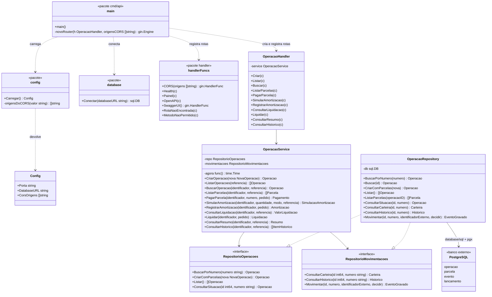
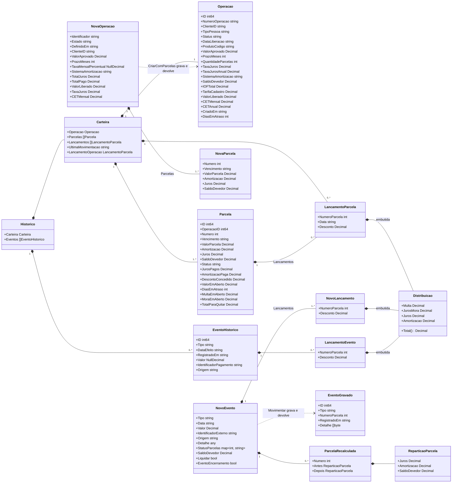
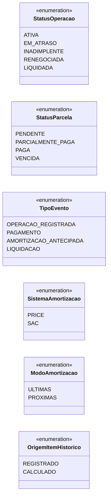
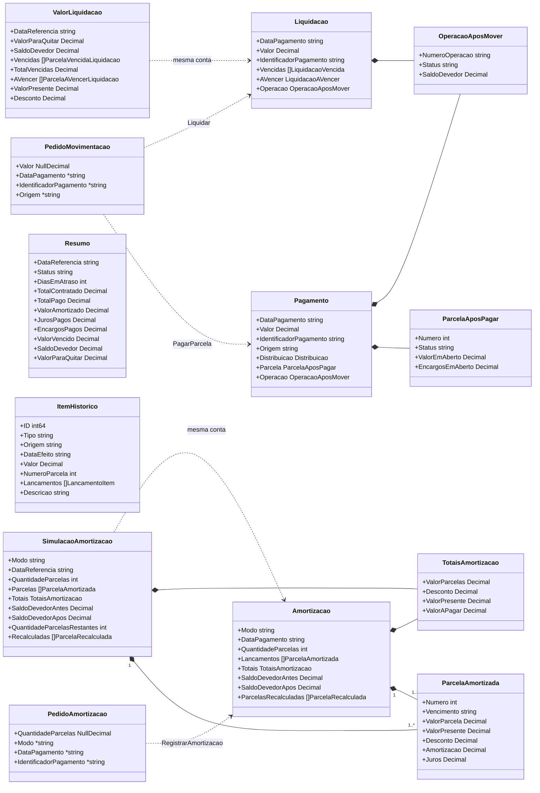
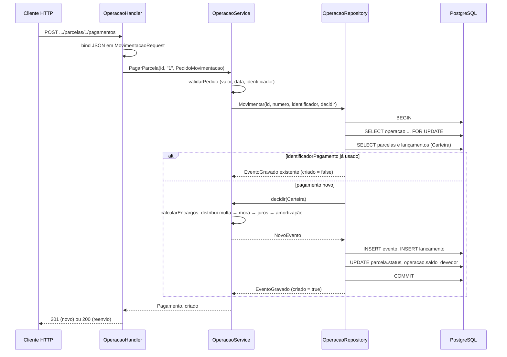

# Diagramas de classe

Diagramas de classe UML do **financial-operations-service**, em [Mermaid](https://mermaid.js.org/), que o GitHub renderiza direto no navegador.

## Como ler um diagrama de classe num projeto Go

Go não tem classes nem herança. A correspondência usada nos diagramas é esta:

| No diagrama | No código Go |
| --- | --- |
| Classe | `struct` com seus campos e os métodos que têm esse `struct` como receptor |
| `<<interface>>` | `interface` declarada em Go |
| Realização (`..|>`) | O `struct` tem todos os métodos da interface. Em Go isso é implícito, não existe `implements` |
| Composição (`*--`) | Campo do `struct` que é outro `struct` ou uma lista dele |
| Dependência (`..>`) | Um tipo recebe ou devolve o outro, sem guardá-lo num campo |
| `<<pacote>>` | Funções soltas de um pacote, sem receptor (ex.: `handler.CORS`) |
| `+` / `-` | Exportado (começa com maiúscula) / não exportado (começa com minúscula) |
| `Decimal` | `decimal.Decimal` da biblioteca `shopspring/decimal` ([ADR-005](../adr/ADR-005-valores-monetarios-decimal.md)) |

Os diagramas mostram os campos e os métodos que importam para entender o desenho. A lista completa de campos fica no código, em `internal/domain/`.

---

## 1. Visão estrutural: camadas e dependências

Como as peças são montadas em `cmd/api/main.go` e quem depende de quem. As setas descem do HTTP para o banco e nunca sobem ([ADR-002](../adr/ADR-002-arquitetura-em-camadas.md)).

Pontos importantes do desenho:

- **O service depende de interfaces, não do repositório concreto.** `RepositorioOperacoes` e `RepositorioMovimentacoes` são declaradas no pacote `service`, que é quem as usa. Nos testes unitários o service recebe dublês em memória, sem banco.
- **Um repositório só realiza as duas interfaces.** `NovoOperacaoService` recebe um `RepositorioOperacoes` e descobre, com uma conversão de tipo, se ele também é um `RepositorioMovimentacoes` (`internal/service/operacao_service.go`). O repositório de verdade é; os dublês dos testes de consulta não precisam ser.
- **Os métodos devolvem também `error`**, e os de criação devolvem ainda um `bool` que diz se o registro é novo (`201`) ou um reenvio (`200`). Os diagramas omitem esses retornos para ficarem legíveis.
- **O `decidir` do `Movimentar`** é uma função do service que o repositório chama dentro da transação, com a operação travada (veja a seção 4).

---

## 2. Modelo de domínio: operação, parcelas e movimentações

Os tipos de `internal/domain/` que as três camadas compartilham. `Operacao` e `Parcela` espelham as tabelas `operacao` e `parcela`; `Carteira` é o retrato da operação que os cálculos usam.

| Tipo | Papel |
| --- | --- |
| `NovaOperacao` / `NovaParcela` | O payload do serviço de juros já convertido pelo handler. A validação preenche os campos derivados (taxas em fração, `DefinidoEmUTC`, `QuantidadeParcelas`). |
| `Operacao` / `Parcela` | O que está gravado, mais os campos **calculados na consulta** para a `dataReferencia` (`DiasEmAtraso`, `ValorEmAberto`, `MultaEmAberto`, `MoraEmAberto`, `TotalParaQuitar`), que nunca vão para o banco (RN-11 e RN-13). |
| `Carteira` | Retrato da operação: parcelas e todos os lançamentos, lido numa transação só. É a entrada de todos os cálculos do service. |
| `Distribuicao` | Para onde foi o dinheiro, na ordem de abatimento da RN-14: multa, mora, juros, amortização. Fica **embutida** (*embedding* do Go) nos lançamentos. |
| `NovoEvento` / `NovoLancamento` | O que um pagamento, uma amortização ou uma liquidação manda gravar: o evento, os lançamentos, os novos status das parcelas e o novo saldo, numa transação ([ADR-012](../adr/ADR-012-eventos-e-lancamentos.md)). |
| `EventoGravado` | O evento já gravado. No reenvio de um `identificadorPagamento`, é o que volta, sem gravar de novo. |
| `Historico` / `EventoHistorico` / `LancamentoEvento` | O que o banco devolve para montar a linha do tempo (RN-21). |

### Status e constantes

Go não tem `enum`: são constantes `string` em `internal/domain/` e o banco confere os valores com `CHECK`. **Só são gravados** `ATIVA` e `LIQUIDADA` na operação, e `PENDENTE`, `PARCIALMENTE_PAGA` e `PAGA` na parcela. `EM_ATRASO`, `INADIMPLENTE` e `VENCIDA` são calculados na consulta (RN-11). `RENEGOCIADA` está reservado para a renegociação, que não foi implementada ([Requisitos não implementados](../../requirements/nao-implementados.md)).

---

## 3. Resultados das operações financeiras

O que cada caso de uso devolve. Os tipos com `json` no código são gravados como `evento.detalhe` (JSONB) e devolvidos iguais no reenvio.

- **A simulação e o registro usam a mesma conta.** `calcularAmortizacao` produz a `SimulacaoAmortizacao`; `RegistrarAmortizacao` chama a mesma função dentro da transação e grava o resultado. O mesmo vale para `calcularLiquidacao` (consulta) e `Liquidar` (registro).
- **Os pedidos usam ponteiro e `NullDecimal`** para separar o campo ausente do campo vazio ou zero. Assim `"valor": 0` é recusado como inválido e um `valor` que não veio é recusado como obrigatório, com mensagens diferentes.

---

## 4. Interação entre as classes num pagamento

O diagrama de classe mostra a estrutura; este diagrama de sequência mostra como as classes acima colaboram no caso mais delicado, o pagamento de parcela (`POST /operacoes/{id}/parcelas/{n}/pagamentos`). Amortização e liquidação seguem o mesmo caminho, trocando o `decidir`.

O `FOR UPDATE` faz dois pagamentos simultâneos da mesma operação rodarem um depois do outro, e o `decidir` roda **dentro** da transação para calcular sobre o saldo já travado. Detalhes em [Dados, transações e idempotência](../../base-de-conhecimento/06-dados-e-consistencia.md).
