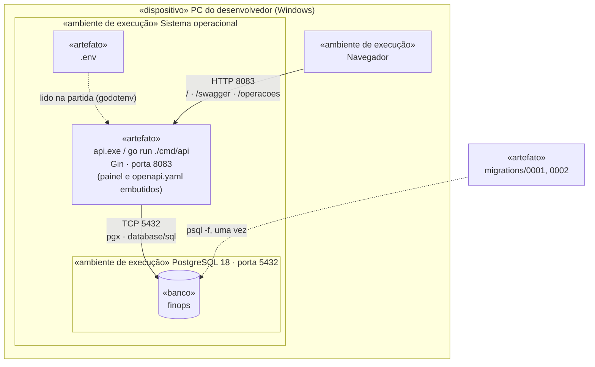
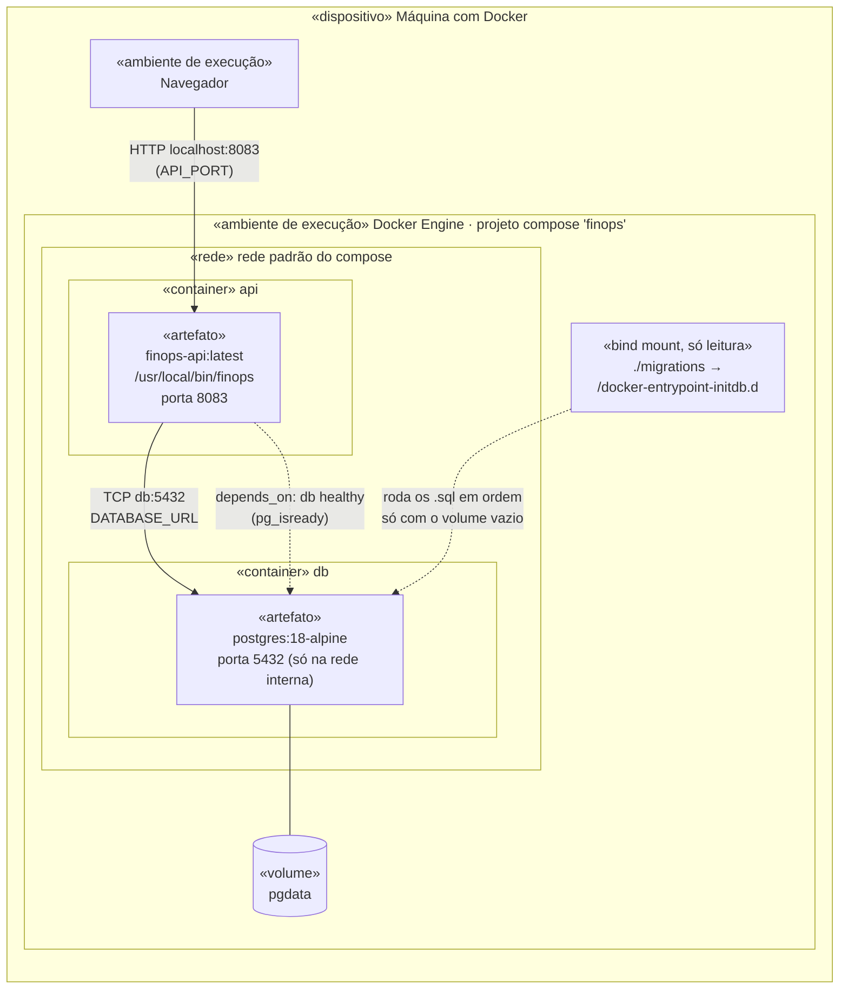
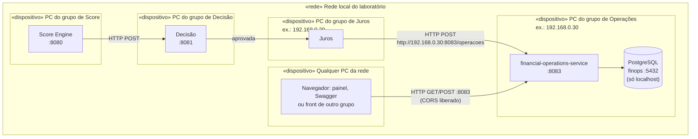

# Diagrama de implantação

Onde cada parte do **financial-operations-service** roda, em quais máquinas, e por quais portas e protocolos as partes se falam. Os diagramas estão em [Mermaid](https://mermaid.js.org/). O Mermaid não tem um tipo próprio de diagrama de implantação UML, então cada **nó** (máquina ou ambiente de execução) é um bloco com o estereótipo entre `«»`, e cada **artefato** implantado é uma caixa dentro dele.

## Artefatos

| Artefato | O que é | Como é gerado |
| --- | --- | --- |
| `finops` / `api.exe` | Binário único da API. Já leva **embutidos** o painel (`web/index.html`) e a especificação (`api/openapi.yaml`), com `go:embed` | `go build ./cmd/api` ou o estágio `build` do `Dockerfile` |
| `finops-api:latest` | Imagem de container com o binário, sobre `alpine:3`, rodando com usuário sem privilégio (`uid 10001`) | `docker compose build` ([ADR-013](../adr/ADR-013-container-para-entrega.md)) |
| `migrations/*.sql` | Schema do banco, aplicado em ordem e nunca editado depois ([ADR-007](../adr/ADR-007-migrations-sql-versionadas.md)) | Escritos à mão |
| Banco `finops` | Banco PostgreSQL 18 com as tabelas `operacao`, `parcela`, `evento` e `lancamento` | `CREATE DATABASE` + migrations |
| `.env` | Configuração: `PORT`, `DATABASE_URL`, `CORS_ORIGINS`. Nunca vai para o Git | Cópia do `.env.example` |

Como o painel e o spec estão dentro do binário, **implantar a API é copiar um arquivo só**. Nada de pasta `static/` para levar junto.

---

## Cenário 1: execução nativa (desenvolvimento e laboratório)

O caminho normal do dia a dia: Go e PostgreSQL instalados direto na máquina do integrante.

| De → Para | Protocolo | Porta | Observação |
| --- | --- | --- | --- |
| Navegador → API | HTTP/1.1, JSON | 8083 | Painel em `/`, Swagger em `/swagger` |
| API → PostgreSQL | Protocolo do PostgreSQL (pgx) | 5432 | `sslmode=disable`, só local |
| Desenvolvedor → PostgreSQL | `psql` | 5432 | Para aplicar as migrations |

---

## Cenário 2: container (entrega para quem não tem Go)

Para rodar na máquina do professor, sem instalar Go nem PostgreSQL ([ADR-013](../adr/ADR-013-container-para-entrega.md)). Um comando: `docker compose up -d --build`.

| Item | Valor | Onde muda |
| --- | --- | --- |
| Porta publicada da API | `8083` | `API_PORT` |
| Porta do banco | **não publicada**, só a API acessa | — |
| Senha do banco | `finops` (só para demonstração) | `POSTGRES_PASSWORD` |
| Origens do CORS | `*` | `CORS_ORIGINS` |
| Saúde da API | `HEALTHCHECK` do `Dockerfile` chama `GET /health` a cada 10 s | `Dockerfile` |
| Saúde do banco | `pg_isready` a cada 3 s; a API só sobe depois | `docker-compose.yml` |
| Dados | Volume `pgdata`, sobrevive a `docker compose down` | `docker compose down -v` apaga |

---

## Cenário 3: a Esteira de Crédito na rede do laboratório

Na apresentação, cada grupo roda o próprio serviço no próprio PC, e os serviços se chamam pelo IP da rede local. Este serviço é a última etapa: só **recebe** chamadas e não chama ninguém ([Integração com sistemas externos](../integracoes.md)).

- **O IP na URL é sempre o da máquina que recebe.** O juros chama `http://IP-DE-OPERACOES:8083/operacoes`.
- **A porta 8083 precisa estar liberada** no firewall do Windows da máquina de Operações, para conexões de entrada. A 5432 não: o banco só é usado pela própria máquina.
- **Cada máquina tem o próprio banco.** Quem abre o painel de um colega (`http://IP:8083/`) vê e mexe nas operações do banco dele, porque o painel sempre chama a API que o serviu.
- Score e Decisão aparecem para dar contexto: não há chamada direta entre eles e este serviço.

---

## O que este diagrama **não** tem, de propósito

Estes elementos são comuns em produção e não existem nesta entrega. Cada um está explicado em [Requisitos não implementados](../../requirements/nao-implementados.md):

- balanceador de carga e mais de uma instância da API;
- HTTPS / TLS e autenticação;
- réplica ou backup automático do banco;
- fila ou barramento de mensagens entre os serviços;
- coleta centralizada de logs e métricas.

A API não guarda estado em memória entre requisições (tudo está no PostgreSQL, e a concorrência é resolvida com trava no banco), então subir mais instâncias atrás de um balanceador não exigiria mudar o código.
