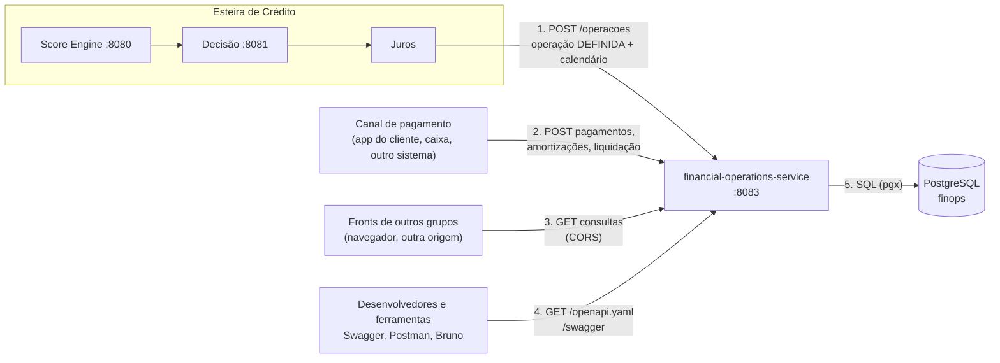
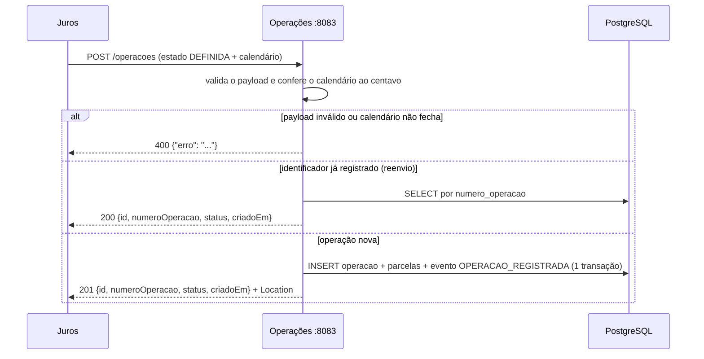

# Integração com sistemas externos

Como o **financial-operations-service** foi projetado para conversar com os outros sistemas: quem o chama, o que ele espera receber, o que devolve, como lida com falhas e reenvios, e como um sistema novo se conecta a ele.

> **Resumo:** este serviço é **passivo**. Ele expõe uma API HTTP/JSON na porta `8083` e **não faz nenhuma chamada de saída**: não chama o juros, não publica eventos, não envia notificações. A única dependência de saída é o próprio PostgreSQL. Quem precisa de algo dele chama a API.

## Mapa de integrações



| # | Sistema externo | Direção | Protocolo | Para quê | Contrato |
| --- | --- | --- | --- | --- | --- |
| 1 | **Serviço de Juros** | entrada | HTTP `POST`, JSON | Registrar a operação fechada com o cliente, com o calendário | [`POST /operacoes`](contracts/README.md#post-operacoes), [ADR-009](adr/ADR-009-operacao-a-partir-da-simulacao-de-juros.md) |
| 2 | **Canal de pagamento** (o cliente, pelo app) | entrada | HTTP `POST`, JSON | Pagar parcela, antecipar parcelas, quitar a operação | [Contratos](contracts/README.md), [ADR-014](adr/ADR-014-concorrencia-e-idempotencia-das-movimentacoes.md) |
| 3 | **Fronts e consultas** (outros grupos, painel) | entrada | HTTP `GET`, JSON, CORS | Situação, parcelas, resumo, histórico, valor para quitar | [Contratos](contracts/README.md), [ADR-016](adr/ADR-016-cors-liberado-e-sem-autenticacao.md) |
| 4 | **Ferramentas de API** | entrada | HTTP `GET` | Descobrir e testar o contrato | `GET /openapi.yaml`, `GET /swagger` ([ADR-008](adr/ADR-008-openapi-escrito-a-mao.md)) |
| 5 | **PostgreSQL** | saída | Protocolo PostgreSQL (`pgx`) | Persistência | [Migrations](../../migrations), [ADR-007](adr/ADR-007-migrations-sql-versionadas.md) |
| — | Score e Decisão | nenhuma | — | Ficam antes do juros na esteira; este serviço não fala com eles | — |

---

## Princípios comuns a todas as integrações

Valem para qualquer sistema que chame a API. O detalhe está no [guia de convenções](contracts/guia-de-convencoes.md).

| Tema | Regra |
| --- | --- |
| **Formato** | JSON em UTF-8, nos dois sentidos. Nomes de campo em `camelCase`, em português. |
| **Identificação da operação** | Pelo `numeroOperacao` (`OP-2026-0001`), o mesmo em toda a esteira. O `id` numérico interno também é aceito, mas só tem sentido aqui ([ADR-011](adr/ADR-011-id-sequencial.md)). |
| **Dinheiro** | Número JSON com até 2 casas decimais. Mais casas são **recusadas**, não arredondadas ([ADR-005](adr/ADR-005-valores-monetarios-decimal.md)). |
| **Taxas** | Entram em **percentual** (`1.85`), como o juros envia, e saem em **fração** (`0.0185`). |
| **Datas** | `YYYY-MM-DD`. Data e hora sem fuso são lidas como **GMT-03:00**; as respostas saem em UTC. |
| **Data de referência** | Toda consulta aceita `?dataReferencia=YYYY-MM-DD` e calcula atraso, encargos e valor presente para aquele dia (RN-09). Sem ela, vale hoje. |
| **Erros** | Sempre `{"erro": "mensagem em português"}`. `400` para dado inválido ou regra violada, `404` para operação ou parcela que não existe, `405` para método errado na rota. |
| **Reenvio seguro** | Todo `POST` pode ser repetido sem duplicar, desde que leve o seu identificador (veja abaixo). |
| **Criado × já existia** | `201 Created` com cabeçalho `Location` quando grava; `200 OK` com o mesmo corpo quando é reenvio. |
| **Autenticação** | Nenhuma nesta fase ([ADR-016](adr/ADR-016-cors-liberado-e-sem-autenticacao.md)). |

---

## 1. Serviço de Juros → registro da operação

É a integração principal: é por ela que as operações entram no serviço.



**O que o juros manda:** a simulação escolhida pelo cliente, como ele já produz, sem adaptação: `operacao` (identificador, estado, definidoEm), `cliente`, `produto`, `condicoes`, `taxa`, `sistema` (`PRICE` ou `SAC`), `resumo`, `encargos`, `valorLiberado`, `cet` e o `calendario` completo. O exemplo inteiro está no Swagger (`POST /operacoes`, exemplos `price` e `sac`) e em [`examples/juros_inbound.json`](../../examples/juros_inbound.json).

**O que este serviço garante:**

- **Só aceita `estado = DEFINIDA`** (RN-01). Simulações em andamento não viram contrato.
- **Não recalcula o calendário** do juros, mas **confere** se ele fecha: parcelas numeradas em ordem, vencimentos crescentes após a liberação, `valor = amortizacao + juros`, saldo encadeado até zero, totais do `resumo` e dos `encargos` batendo. Se algo não fechar, recusa com `400` e diz o quê (RN-03).
- **Grava a operação, as parcelas e o evento de registro numa transação só.** Nunca existe operação sem calendário (RN-04).
- **Idempotência pelo `operacao.identificador`.** O juros pode reenviar quantas vezes quiser (por timeout, por exemplo). Dois envios simultâneos também resultam numa operação só, garantida pelo `UNIQUE` do banco.
- **A resposta só confirma o registro** (`id`, `numeroOperacao`, `status`, `criadoEm`). O juros já tem os dados que mandou.

**Campos aceitos e ignorados** (para o juros não precisar mudar o payload): `operacao.id`, `operacao.criadoEm`, `condicoes.primeiroRelacionamento`, `resumo.parcelaFixa`, `demonstrativo` e `calendario[].diasCorridos`. Campos desconhecidos também são ignorados, então o juros pode acrescentar campos sem quebrar a integração.

**O que o juros deve fazer em cada resposta:**

| Resposta | Significado | Ação recomendada |
| --- | --- | --- |
| `201` | Registrada agora | Seguir |
| `200` | Já estava registrada | Seguir; não é erro |
| `400` | Payload recusado | Não reenviar igual: corrigir o dado apontado em `erro` |
| Timeout / sem resposta | Não se sabe se gravou | **Reenviar o mesmo payload**: é seguro |

---

## 2. Canal de pagamento → movimentações financeiras

Quem paga é o cliente, por exemplo pelo app (alinhado com o grupo de juros). O contrato é genérico para aceitar outros chamadores sem mudança: um caixa, um sistema de cobrança ou um conciliador bancário.

| Ação | Endpoint | Regra |
| --- | --- | --- |
| Pagar uma parcela, total ou parcial | `POST /operacoes/{numeroOperacao}/parcelas/{n}/pagamentos` | RN-14 |
| Simular a antecipação de N parcelas | `GET /operacoes/{numeroOperacao}/amortizacoes/simulacao?quantidadeParcelas=N&modo=ULTIMAS` | RN-16, RN-17 |
| Antecipar N parcelas | `POST /operacoes/{numeroOperacao}/amortizacoes` | RN-17 |
| Consultar o valor para quitar | `GET /operacoes/{numeroOperacao}/liquidacao?dataReferencia=...` | RN-18 |
| Quitar a operação | `POST /operacoes/{numeroOperacao}/liquidacao` | RN-18, RN-19 |

Exemplo de pagamento:

```json
POST /operacoes/OP-2026-0001/parcelas/1/pagamentos
{ "valor": 500, "dataPagamento": "2026-12-10", "identificadorPagamento": "app-7f3a91", "origem": "CLIENTE" }
```

**Campos que o chamador controla:**

| Campo | Para quê |
| --- | --- |
| `dataPagamento` | O dia em que o dinheiro entrou, não o dia em que a API foi chamada. Não pode ser futuro, nem anterior à liberação, nem anterior à última movimentação (só para frente, RN-09). Sem ele, vale hoje. |
| `identificadorPagamento` | **Chave de idempotência**, até 50 caracteres. Mandar o mesmo valor de novo devolve o pagamento já gravado (`200`), sem cobrar duas vezes. Usado em outra parcela ou em outro tipo de movimentação, é recusado com `400` ([ADR-014](adr/ADR-014-concorrencia-e-idempotencia-das-movimentacoes.md)). |
| `origem` | Texto livre, até 30 caracteres, para rastrear de onde veio (ex.: `CLIENTE`, `CAIXA`). Não é conferido. |

**Recomendações para quem integra:**

- **Sempre mande `identificadorPagamento`** (o id da transação do seu lado). Sem ele, um reenvio por timeout vira um segundo pagamento.
- **Consulte antes de cobrar.** O valor para quitar uma parcela muda a cada dia de atraso (multa e mora, RN-13). Use `GET .../parcelas?dataReferencia=...` (campo `totalParaQuitar`) ou `GET .../liquidacao` antes de pedir o dinheiro ao cliente.
- **Simule antes de antecipar.** O `GET .../amortizacoes/simulacao` faz a mesma conta do `POST` sem gravar nada.
- A liquidação exige o **valor exato** do dia; qualquer diferença é recusada com a mensagem do valor certo.
- Pagamentos simultâneos da mesma operação são processados um de cada vez, então o chamador não precisa coordenar isso.

---

## 3. Fronts e consultas

Qualquer sistema que precise **ler** a carteira usa os `GET`:

| Pergunta | Endpoint |
| --- | --- |
| Quais operações existem e em que situação? | `GET /operacoes?dataReferencia=...` |
| Como está esta operação? | `GET /operacoes/{numeroOperacao}` |
| Quanto falta de cada parcela, com encargos? | `GET /operacoes/{numeroOperacao}/parcelas` |
| Quanto foi pago, de quê, e quanto falta? | `GET /operacoes/{numeroOperacao}/resumo` |
| O que aconteceu com esta operação? | `GET /operacoes/{numeroOperacao}/historico` |

- **Do navegador, de outra origem:** o CORS vem liberado (`CORS_ORIGINS=*`). O preflight `OPTIONS` responde `204`, e o `Location` das respostas `201` é exposto ao JavaScript ([ADR-016](adr/ADR-016-cors-liberado-e-sem-autenticacao.md)).
- **O painel embutido** em `http://IP:8083/` é um front pronto, da mesma origem, que não depende de CORS ([ADR-015](adr/ADR-015-painel-web-embutido.md)).
- **A situação é sempre calculada na hora** para a `dataReferencia` (RN-11). Um front que guarda a resposta em cache deve guardar junto a data de referência.
- **A listagem não é paginada.** No volume do projeto isso não pesa; um consumidor que espere milhares de operações deve combinar paginação antes.

---

## 4. Descoberta do contrato

| Recurso | Onde | Uso |
| --- | --- | --- |
| Especificação OpenAPI 3 | `GET /openapi.yaml` e [`api/openapi.yaml`](../../api/openapi.yaml) | Importar no Postman, Insomnia ou Bruno, ou gerar um client |
| Swagger UI | `GET /swagger` | Ler e testar pelo navegador (**Try it out**) |
| Coleção de testes | [`collections/`](../../collections) (Postman, abre também no Bruno) e [`bruno/`](../../bruno) | Rodar o fluxo inteiro, inclusive os cenários de erro |
| Contrato em texto | [Contratos da API](contracts/README.md) | Regras, exemplos e todas as mensagens de erro |

O `openapi.yaml` é a **fonte oficial**. Um teste (`TestOpenAPICobreTodasAsRotas`) falha se alguma rota do router não estiver documentada nele, e outro valida os exemplos contra os schemas ([ADR-008](adr/ADR-008-openapi-escrito-a-mao.md)).

---

## 5. PostgreSQL

A única dependência de saída.

- **Driver:** `pgx` v5 via `database/sql`, sem ORM ([ADR-001](adr/ADR-001-stack-go-gin-postgres.md)).
- **Conexão:** `DATABASE_URL`. Na partida a API faz um `Ping`; se o banco não responder, ela **não sobe** e mostra o erro.
- **Schema:** aplicado pelas migrations versionadas em `migrations/`, nunca pela API ([ADR-007](adr/ADR-007-migrations-sql-versionadas.md)). No container, o próprio PostgreSQL as aplica no primeiro start ([ADR-013](adr/ADR-013-container-para-entrega.md)).
- **Consistência:** transações em toda escrita, `FOR UPDATE` nas movimentações e `CHECK`, `UNIQUE` e `FOREIGN KEY` no banco como última barreira.
- **Nenhum outro sistema deve ler ou escrever direto nas tabelas.** O banco é privado do serviço; a integração é sempre pela API. Isso permite mudar o schema sem quebrar ninguém.

---

## O que **não** existe hoje e como seria acrescentado

| Necessidade | Situação | Caminho previsto |
| --- | --- | --- |
| Avisar outro sistema quando uma operação fica inadimplente ou é liquidada | Não existe: a situação é calculada na consulta e nenhum evento sai do serviço ([ADR-012](adr/ADR-012-eventos-e-lancamentos.md)) | Um job diário que grava eventos novos na tabela `evento` e os publica (webhook ou fila), com *outbox* para não perder mensagens |
| Autenticar o juros e o canal de pagamento | Não existe ([ADR-016](adr/ADR-016-cors-liberado-e-sem-autenticacao.md)) | Chave de API por chamador ou JWT, num middleware antes das rotas, como o do CORS |
| Renegociação | Não implementada: depende do grupo de juros para gerar as novas condições | Novo `POST` recebendo o novo calendário do juros, com o status `RENEGOCIADA` já previsto no banco |

O detalhe de cada item está em [Requisitos não implementados](../requirements/nao-implementados.md).

## Checklist para integrar um sistema novo

1. Leia o [contrato](contracts/README.md) ou abra `http://IP:8083/swagger`.
2. Rode a [coleção](../../collections) contra uma instância local para ver as respostas reais.
3. Identifique a operação pelo `numeroOperacao`.
4. Em todo `POST`, mande um identificador próprio (`operacao.identificador` ou `identificadorPagamento`) e trate `200` e `201` como sucesso.
5. Trate `400` como erro definitivo (não reenvie igual) e timeout como "reenviar o mesmo".
6. Mande dinheiro com até 2 casas e taxas em percentual; leia as taxas da resposta em fração.
7. Se chamar do navegador de outra origem, confirme que ela está em `CORS_ORIGINS`.
8. Peça ao time deste serviço para liberar a porta `8083` no firewall da máquina onde ele roda.
