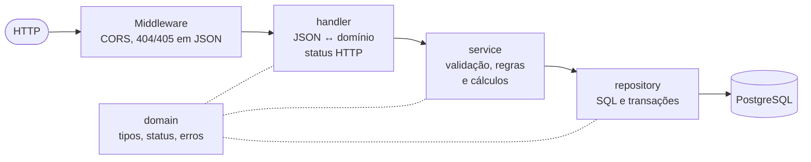

# 02. Arquitetura e mapa do código

## Em uma imagem

Camadas em `internal/`, ligadas à mão em `cmd/api/main.go`, sem framework de injeção de dependência ([ADR-002](../architecture/adr/ADR-002-arquitetura-em-camadas.md)). As dependências só descem. O diagrama completo, com classes e interfaces, está em [Diagramas de classe](../architecture/diagrams/classes.md).

## O que cada camada pode e não pode fazer

| Camada | Pode | **Não** pode |
| --- | --- | --- |
| `cmd/api` | Ler a config, abrir o banco, montar o router | Ter regra de negócio |
| `handler` | Fazer o *bind* do JSON, converter request ↔ domínio, escolher o status HTTP, ler query string | Validar regra de negócio, acessar o banco |
| `service` | Validar a entrada, aplicar as RNs, calcular tudo, decidir o que gravar | Montar SQL, conhecer o Gin |
| `repository` | Executar SQL, abrir e fechar transações, travar linhas | Validar ou calcular regra de negócio |
| `domain` | Declarar tipos, constantes e erros compartilhados | Depender de qualquer outra camada |

Se você está em dúvida sobre onde pôr uma linha, pergunte "isto muda se a regra de negócio mudar?". Se sim, é `service`.

## Mapa do código

| Arquivo | O que tem | Abra quando… |
| --- | --- | --- |
| `cmd/api/main.go` | `main` (config, banco, injeção) e `novoRouter` (**todas as rotas**) | quiser saber que endpoints existem |
| `internal/config/config.go` | `PORT`, `DATABASE_URL`, `CORS_ORIGINS` e seus padrões | for acrescentar uma variável de ambiente |
| `internal/database/database.go` | Abre a conexão `pgx` e faz o `Ping` | a API não sobe por causa do banco |
| `internal/domain/operacao.go` | `Operacao`, `NovaOperacao`, status da operação, `PRICE`/`SAC` | for mexer nos campos da operação |
| `internal/domain/parcela.go` | `Parcela`, `NovaParcela`, status da parcela | for mexer nos campos da parcela |
| `internal/domain/movimentacao.go` | Carteira, eventos, lançamentos, pagamento, liquidação, amortização, resumo e histórico | for mexer em qualquer movimentação |
| `internal/domain/erros.go` | Erros que viram `404` | for criar um "não encontrado" novo |
| `internal/handler/operacao_handler.go` | Requests e responses da operação e das parcelas, `responderErro`, `dataReferenciaQuery` | for mudar o JSON de entrada ou saída |
| `internal/handler/movimentacao_handler.go` | Pagamento, liquidação, resumo, histórico | idem, para movimentações |
| `internal/handler/amortizacao_handler.go` | Simulação e registro da amortização | idem, para amortização |
| `internal/handler/cors_handler.go` | Middleware de CORS | outro front não consegue chamar a API |
| `internal/handler/painel_handler.go`, `docs_handler.go` | Serve o painel, o `openapi.yaml` e o Swagger UI | — |
| `internal/service/operacao_service.go` | `OperacaoService`, as interfaces de repositório, criar/listar/buscar | for entender a injeção ou o reenvio do juros |
| `internal/service/validacao.go` | Todas as validações do payload do juros, fuso, taxas | o juros reclamar de um `400` |
| `internal/service/calendario.go` | Conferência do calendário recebido | o juros reclamar que o calendário "não fecha" |
| `internal/service/atraso.go` | Data de referência, parcela vencida, situação da operação | mexer em atraso ou inadimplência |
| `internal/service/encargos.go` | Multa, mora e total para quitar | mexer em encargos |
| `internal/service/movimentacao.go` | Pagamento e liquidação (`decidirPagamento`, `calcularLiquidacao`, `decidirLiquidacao`) | mexer em pagamento ou quitação |
| `internal/service/valor_presente.go` | Fração do período e valor presente | mexer em desconto de antecipação |
| `internal/service/amortizacao.go` | Simulação e registro da antecipação, recálculo das parcelas restantes | mexer em amortização |
| `internal/service/resumo.go` | Resumo financeiro | mudar um total |
| `internal/service/historico.go` | Linha do tempo (eventos gravados + itens calculados) | mudar o histórico |
| `internal/repository/operacao_repository.go` | Inserir operação e parcelas, listar, buscar, *scan* das linhas | mexer no SQL da operação |
| `internal/repository/movimentacao_repository.go` | `Movimentar` (a transação das movimentações), `ConsultarCarteira`, `ConsultarHistorico` | mexer em como as movimentações são gravadas |
| `internal/repository/situacao_repository.go` | Lê operação, parcelas e lançamentos para as consultas | a situação calculada estiver estranha |
| `api/openapi.yaml` + `api/openapi.go` | O contrato, embutido no binário | mudar qualquer endpoint |
| `web/index.html` + `web/web.go` | O painel, embutido no binário ([ADR-015](../architecture/adr/ADR-015-painel-web-embutido.md)) | mudar a interface |
| `migrations/*.sql` | Schema do banco | — (crie uma nova, nunca edite) |
| `cmd/api/*_test.go` | Testes do router, do OpenAPI, do CORS e de integração com banco | — |

## O caminho de uma requisição

Exemplo: `GET /operacoes/OP-2026-0001/parcelas?dataReferencia=2026-12-10`.

1. **Router** (`novoRouter`): o CORS roda primeiro; a rota casa com `operacaoHandler.ListarParcelas`.
2. **Handler** (`ListarParcelas`): lê o `:identificador` e a `dataReferencia` (`dataReferenciaQuery` devolve `nil` se o parâmetro não veio) e chama o service.
3. **Service** (`ListarParcelas` → `consultarSituacao`):
   - `identificarOperacao` decide se o identificador é um `numeroOperacao` (`OP-...`) ou um `id` numérico;
   - `interpretarDataReferencia` valida a data ou usa hoje em GMT-03:00;
   - pede ao repository a operação, as parcelas e os lançamentos;
   - `calcularSituacaoParcelas` calcula, para cada parcela, `VENCIDA`, dias em atraso e encargos (`calcularEncargos`).
4. **Repository** (`ConsultarSituacao`): lê tudo numa transação só leitura, para os dados virem do mesmo instante.
5. **Handler** converte para `[]ParcelaResponse` e responde `200`. Se o service devolveu erro, `responderErro` escolhe `404` ou `400`.

As **escritas de dinheiro** seguem outro caminho, com trava e idempotência: veja o diagrama de sequência em [Diagramas de classe, seção 4](../architecture/diagrams/classes.md#4-interação-entre-as-classes-num-pagamento) e [Dados e consistência](06-dados-e-consistencia.md).

## Padrões que se repetem

Reconhecê-los torna o código bem mais fácil de ler.

### Cálculo puro + casca com I/O

Toda regra financeira é uma função **pura** (sem banco, sem relógio) que recebe uma `Carteira` e uma data:

| Casca (faz I/O) | Função pura (é testada) |
| --- | --- |
| `PagarParcela` | `decidirPagamento(carteira, numero, movimento)` |
| `ConsultarLiquidacao` / `Liquidar` | `calcularLiquidacao(carteira, data)` / `decidirLiquidacao(carteira, movimento)` |
| `SimularAmortizacao` / `RegistrarAmortizacao` | `calcularAmortizacao(carteira, n, modo, data)` / `decidirAmortizacao(...)` |
| `ConsultarResumo` | `calcularResumo(carteira, data)` |
| `ConsultarHistorico` | `montarHistorico(historico, data)` |

Uma regra nova deve seguir o mesmo formato: a conta numa função pura e testada, a casca só busca os dados e grava o resultado.

### Simulação e registro usam a mesma conta

A simulação da amortização e a consulta do valor de liquidação chamam **a mesma função** que o registro. Por isso o número mostrado na simulação é exatamente o que será gravado. Nunca duplique a conta.

### O relógio é injetado

`OperacaoService.agora` é `time.Now` em produção e um valor fixo nos testes. Nunca chame `time.Now()` direto no service.

### "Ausente" é diferente de "zero"

Requests usam ponteiros (`*string`) e `decimal.NullDecimal` para distinguir um campo que não veio de um campo vazio ou zero. Isso permite mensagens precisas ("`valor` é obrigatório" × "`valor` deve ser maior que zero") e evita que uma taxa ausente vire empréstimo sem juros.

### Erros são mensagens para quem chama

Erros de regra são criados com `errors.New("mensagem em português")` e vão direto para o JSON (`{"erro": "..."}`). Escreva a mensagem pensando em quem vai lê-la no outro grupo: diga o campo, o problema e, se possível, o valor esperado. Os erros que viram `404` ficam em `internal/domain/erros.go` e são verificados com `errors.Is`.

### Comentários explicam o porquê

O código quase não tem comentários do tipo "incrementa o contador". Os que existem explicam **por que** algo é como é, muitas vezes citando a RN ou o ADR. Mantenha esse padrão.

## Dependências externas (Go)

| Biblioteca | Para quê |
| --- | --- |
| `gin-gonic/gin` | Router e HTTP |
| `jackc/pgx/v5` | Driver do PostgreSQL (via `database/sql`) |
| `shopspring/decimal` | Dinheiro e taxas com precisão exata |
| `joho/godotenv` | Ler o `.env` |
| `swaggo/gin-swagger`, `swaggo/files` | Servir o Swagger UI |
| `getkin/kin-openapi` | Validar o `openapi.yaml` nos testes |

Não há ORM, nem framework de injeção, nem biblioteca de validação. É de propósito ([ADR-001](../architecture/adr/ADR-001-stack-go-gin-postgres.md)): menos coisa para a equipe aprender e tudo explícito no código.
