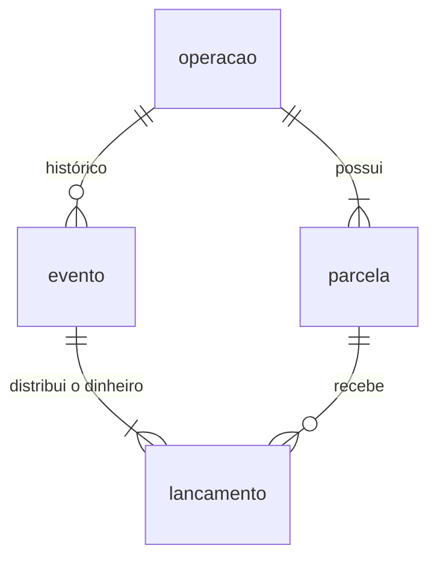

# 06. Dados, transações e idempotência

## Modelo de dados

Quatro tabelas, criadas por duas migrations. O diagrama ER completo, com todas as colunas, está em [Diagramas, Modelo de dados](../architecture/diagrams/README.md#modelo-de-dados).



| Tabela | Migration | Uma linha é… | Muda depois de criada? |
| --- | --- | --- | --- |
| `operacao` | `0001` | Um contrato | Só `status` e `saldo_devedor` |
| `parcela` | `0001` | Uma prestação do calendário | Só `status`, e `juros`/`amortizacao`/`saldo_devedor` quando uma amortização antecipada refaz a repartição (RN-17) |
| `evento` | `0002` | Um fato: registro, pagamento, amortização, liquidação | **Nunca** (só inclusão) |
| `lancamento` | `0002` | O dinheiro de um evento numa parcela, por componente | **Nunca** (só inclusão) |

## Gravado × calculado

A regra mais importante para entender o modelo ([ADR-012](../architecture/adr/ADR-012-eventos-e-lancamentos.md)):

| Informação | Gravada? | De onde sai |
| --- | --- | --- |
| Status `ATIVA`, `LIQUIDADA` | Sim | `operacao.status` |
| Status `PENDENTE`, `PARCIALMENTE_PAGA`, `PAGA` | Sim | `parcela.status` |
| Status `VENCIDA`, `EM_ATRASO`, `INADIMPLENTE` | **Não** | Vencimento × lançamentos × data de referência |
| Dias em atraso | **Não** | Idem |
| Saldo devedor | Sim | `operacao.saldo_devedor`, atualizado em toda movimentação |
| Valor pago, juros pagos, encargos pagos | **Não** | Soma dos lançamentos |
| Multa e mora em aberto | **Não** | `calcularEncargos` sobre os lançamentos |
| Valor presente, valor para quitar | **Não** | Calculados na data |
| Resumo e histórico | **Não** | Montados a partir dos eventos e lançamentos |

**Por que assim:** o atraso muda com o passar do tempo, sem ninguém chamar a API. Gravá-lo exigiria um job diário, e um job que falha deixa o banco errado. Calculado, nunca fica velho e funciona para qualquer `dataReferencia`. E com o dinheiro numa fonte só (os lançamentos), o resumo, o histórico e os encargos nunca divergem entre si.

**Consequência prática:** nunca escreva um `UPDATE` para "corrigir" um valor pago. Se algo foi gravado errado, a correção é um **evento novo** (um estorno), não uma edição.

## Garantias do banco

O banco é a última barreira. Mesmo que o service tenha um bug, estas regras impedem dado inconsistente:

| Garantia | Onde |
| --- | --- |
| `numero_operacao` único | `UNIQUE` em `operacao` |
| Uma parcela por número em cada operação | `UNIQUE (operacao_id, numero)` em `parcela` |
| Status só com valores conhecidos | `CHECK` em `operacao.status`, `parcela.status`, `evento.tipo` |
| `identificadorPagamento` único por operação | `UNIQUE (operacao_id, identificador_externo)` em `evento` (vários `NULL` são permitidos) |
| Lançamento soma certo | `CHECK (valor = multa + juros_mora + juros + amortizacao)` |
| Nenhum componente negativo | `CHECK (... >= 0)` em cada coluna de `lancamento` |
| Lançamento é da mesma operação do evento | `FOREIGN KEY (evento_id, operacao_id)` → `evento(id, operacao_id)` |
| Lançamento aponta para parcela que existe | `FOREIGN KEY (operacao_id, numero_parcela)` → `parcela` (não conferida quando `numero_parcela` é nulo, o caso da liquidação) |

## Transações

| Operação | Transação | Por quê |
| --- | --- | --- |
| `POST /operacoes` | Uma só para operação + parcelas + evento `OPERACAO_REGISTRADA` | Nunca existe operação sem calendário (RN-04) |
| Pagamento, amortização, liquidação | Uma só, com `SELECT ... FOR UPDATE` na operação | Duas movimentações simultâneas não calculam sobre o mesmo saldo ([ADR-014](../architecture/adr/ADR-014-concorrencia-e-idempotencia-das-movimentacoes.md)) |
| Consultas (situação, carteira, histórico) | `REPEATABLE READ`, somente leitura | Parcelas e lançamentos vêm do mesmo instante; nada de ver a parcela "depois" do pagamento e o lançamento "antes" |

O padrão em todo o repository é:

```go
tx, err := r.db.Begin()
if err != nil { return ..., err }
defer tx.Rollback()     // não faz nada se o Commit já rodou
// ... consultas e escritas com tx ...
return ..., tx.Commit()
```

## Idempotência (reenvios)

Todo `POST` pode ser repetido sem duplicar:

| Endpoint | Chave | Reenvio |
| --- | --- | --- |
| `POST /operacoes` | `operacao.identificador` (= `numeroOperacao`) | `200` com a operação já gravada |
| Pagamento, amortização, liquidação | `identificadorPagamento` (opcional) | `200` com o mesmo corpo da primeira resposta, lido de `evento.detalhe` |

Dois detalhes que costumam escapar:

- **Corrida no registro da operação.** Dois envios simultâneos do mesmo identificador podem passar os dois pelo "já existe?". O segundo `INSERT` bate no `UNIQUE`, o repository devolve `domain.ErrOperacaoJaRegistrada`, e o service busca e devolve a operação gravada pelo primeiro (`CriarOperacao`).
- **Mesmo identificador, outra ação.** Usar o `identificadorPagamento` de um pagamento da parcela 1 num pagamento da parcela 2 (ou numa liquidação) é recusado com `400`, para não devolver um recibo que não corresponde ao pedido.

## Dinheiro e precisão

- **Nunca use `float64` para dinheiro ou taxa.** Use `decimal.Decimal` ([ADR-005](../architecture/adr/ADR-005-valores-monetarios-decimal.md)). No banco: `NUMERIC(15,2)` para dinheiro e `NUMERIC(10,6)` para taxas.
- Entrada com mais de 2 casas é **recusada**, não arredondada. Arredondar em silêncio esconderia um erro de quem chamou.
- Cálculos intermediários (mora, potência da taxa) usam precisão cheia; **só o resultado** é arredondado, meio para cima (`Round(2)`).
- Compare com `.Equal()`, nunca com `==`: `decimal.Decimal` é uma struct, e `==` compara a representação interna.
- No JSON, o decimal sai como **número** (`936.91`), não como texto, porque `main` define `decimal.MarshalJSONWithoutQuotes = true`. Zeros à direita somem (`185.00` → `185`).
- Taxas: o juros manda **percentual** (`1.85`), o banco e as respostas usam **fração** (`0.0185`). A conversão acontece uma vez, em `validarTaxas`.

## Datas e fuso

- Datas de negócio (`vencimento`, `dataPagamento`, `dataReferencia`) são **dias**, sem hora, guardadas como `DATE` e tratadas como texto `YYYY-MM-DD` no domínio. Comparar como texto funciona porque o formato é ordenável.
- Os dias são interpretados em **GMT-03:00** (`fusoJuros`), o mesmo fuso combinado com o juros.
- Data e hora (`definidoEm`, `criadoEm`, `registradoEm`) são `TIMESTAMPTZ` e saem em **UTC** com `Z`.
- `diasEntre` conta dias corridos pela diferença de horário Unix. Como os dois lados são meia-noite no mesmo fuso fixo (sem horário de verão), a divisão por 86.400 é exata.
